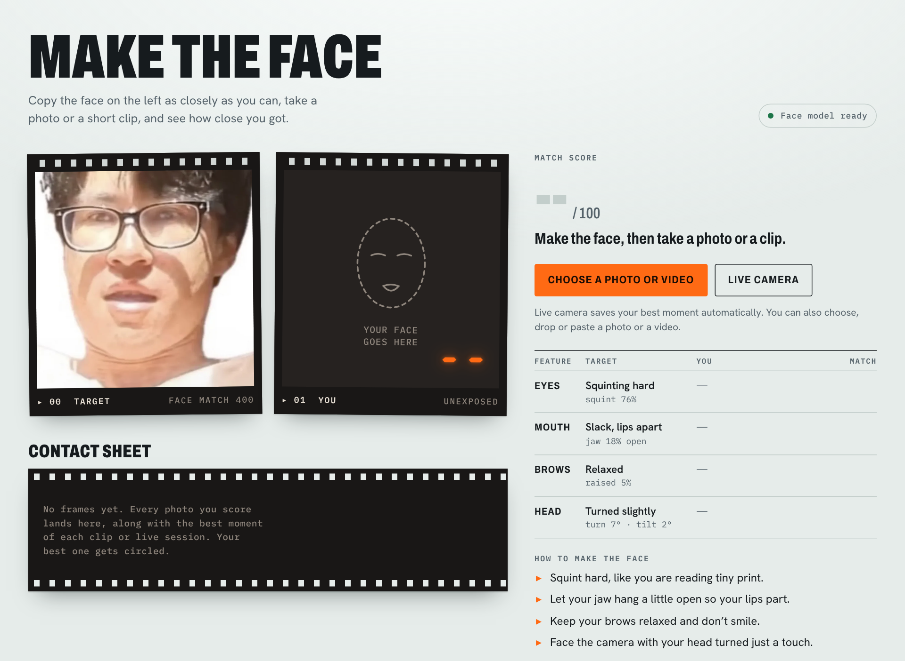

# Make The Face

Copy a face and find out how close you got. Make The Face reads the expression in a target photo with Google's MediaPipe face model, then scores your selfie, video clip or live webcam against it from 0 to 100 and tells you what to change.



It's a single HTML file with no build step and no server. The face model runs in your browser, so photos and video never leave your device.

## Features

- **Three ways to play:** a photo (take a selfie or pick one), a short video clip, or the live webcam.
- **A score from 0 to 100** with a rank, from *Total stranger* to *Separated at birth*.
- **Feature-by-feature breakdown** for eyes, mouth, brows and head, each rated *Spot on*, *Close* or *Off*, plus up to three tips such as "Squint harder" or "Lose the smile".
- **Your best moment, saved automatically.** Clips are scanned frame by frame, and live sessions keep their best frame as you go. A chart shows your score over time with the best moment marked.
- **Contact sheet** of your last 12 attempts, kept in your browser, with your best one circled.
- **Result card:** save a PNG of the target next to your attempt, with your score stamped on it.
- **Tracker overlay** showing the face outline the model measured.
- Works on phones and desktops, in light and dark mode.

## Run it

The whole app is `index.html`. The first time it opens, it downloads the face model and its runtime (about 13 MB) from jsDelivr and Google Cloud Storage, so it needs an internet connection.

- **Open the file:** open `index.html` in Chrome or Edge. The live camera works from a local file in Chrome.
- **Serve it locally:**

  ```bash
  python3 -m http.server 8000
  ```

  Then go to <http://localhost:8000>.
- **Publish with GitHub Pages:** in the repository, go to **Settings → Pages**, set **Source** to **Deploy from a branch**, choose your default branch and the `/ (root)` folder, and save. The app appears at `https://<username>.github.io/<repository>/`.

The live camera needs camera permission and a secure page (HTTPS, `localhost` or a local file). GitHub Pages is served over HTTPS, so it works there.

## How to play

1. Study the target. The panel spells out what defines it: eyes squinted hard, jaw hanging slightly open with the lips apart, brows relaxed, no smile, head turned about 7°.
2. Make the face and capture it:
   - **Choose a photo or video** works on any device. You can also drop or paste a photo or video onto the page.
   - **Take a selfie** and **Record a clip** appear on phones and tablets and open the camera. For a clip, hold the face for a few seconds; the app finds your best moment.
   - **Live camera** scores you as you move and saves your best moment automatically (turn this off with **Auto-save my best**). **Snap**, or the Space bar, keeps the current frame, and **Stop camera** shows your best.
3. Read the breakdown and tips, adjust, and go again.

## How the score works

[MediaPipe Face Landmarker](https://developers.google.com/edge/mediapipe/solutions/vision/face_landmarker) finds 478 points on the face, 52 expression scores called blendshapes (such as `jawOpen` and `eyeSquintLeft`) and the head's rotation. From those, the app takes 18 measurements in four regions:

| Region | Measurements |
| --- | --- |
| Eyes | squint, blink, eye opening (lid gap ÷ eye width), widening |
| Brows | raise, furrow |
| Mouth | jaw open, lip gap (inner-lip gap ÷ mouth width), smile, frown, pucker, stretch, sneer, cheek puff, lip roll |
| Head | turn, nod, tilt |

Then:

1. **Every image is read twice,** as-is and mirrored, and the two readings are averaged. Live mode alternates plain and mirrored frames and smooths them over time.
2. **The target was measured the same way across 36 variations of its photo** (mirrored, rotated ±4°, rescaled and padded). Each measurement's target value is the average reading, and its tolerance band is widened by how much that reading wobbled (1.25 × its standard deviation). The steady squint gets a tight band; the ambiguous mouth gets a wider one.
3. **Each measurement scores fully inside its band** and falls off smoothly outside it.
4. **Measurements are weighted by how much they define the target,** which here means the squint and the open jaw. Regions are weighted the same way.
5. **Movement the target doesn't have,** such as a smile or raised eyebrows, scales the score down.
6. **Selfies come out mirrored on some phones,** so the score is worked out both ways round and the better result is kept.
7. The final score is `100 × match^1.8 × penalties`.

It compares expressions, not identities: it doesn't try to judge whether you look like the person.

| Score | Rank |
| --- | --- |
| 95–100 | Separated at birth |
| 85–94 | Uncanny |
| 70–84 | Strong resemblance |
| 50–69 | Family resemblance |
| 30–49 | Distant relative |
| 0–29 | Total stranger |

The target photo scores 100 against itself. On simulated readings, a neutral face scores about 27, a big grin about 45 and a decent imitation about 94. The tuning hasn't yet been checked against a panel of real faces.

## Privacy

- Photos, clips and camera frames are processed in the browser and never uploaded.
- The page loads the face model and its runtime from jsDelivr and Google Cloud Storage, and its fonts from Google Fonts. Nothing else goes over the network.
- Your attempts (small thumbnails, measurements and scores) are saved in the browser's local storage so the contact sheet survives a reload. **Clear frames** deletes them.

## Project layout

```
index.html            the whole app: markup, styles, scoring code and the embedded target photo
docs/screenshot.png   the screenshot in this README
```

The target photo and its pre-measured values are embedded in `index.html` (the `TARGET` constant in the script), so changing the target face means measuring a new photo.

## Optional: host the model yourself

The page first looks for the model files in an `mp/` folder next to it and falls back to the CDNs when they're missing, so a couple of 404s in the console are expected. To serve everything yourself, for example for offline use, add:

```
mp/vision_bundle.mjs
mp/wasm/vision_wasm_internal.js
mp/wasm/vision_wasm_internal.wasm
mp/wasm/vision_wasm_nosimd_internal.js
mp/wasm/vision_wasm_nosimd_internal.wasm
mp/face_landmarker.task.txt
```

The first five come from version 0.10.21 of the [`@mediapipe/tasks-vision`](https://www.npmjs.com/package/@mediapipe/tasks-vision) package:

```bash
npm pack @mediapipe/tasks-vision@0.10.21
tar xzf mediapipe-tasks-vision-0.10.21.tgz
mkdir -p mp/wasm
cp package/vision_bundle.mjs mp/
cp package/wasm/vision_wasm_internal.* package/wasm/vision_wasm_nosimd_internal.* mp/wasm/
```

The last is the face model, saved as base64 text:

```bash
curl -LO https://storage.googleapis.com/mediapipe-models/face_landmarker/face_landmarker/float16/1/face_landmarker.task
base64 -w0 face_landmarker.task > mp/face_landmarker.task.txt    # Linux
base64 -i face_landmarker.task -o mp/face_landmarker.task.txt    # macOS
```

Your server needs to send `.mjs` files as JavaScript. If a file can't be loaded, the page falls back to the CDN.

## Browser support

Built and tested in Chromium. It needs WebAssembly and WebGL 2, which current versions of Chrome, Edge, Firefox and Safari all have.

Clips play in whatever formats the browser can decode. Desktop Chrome, for example, may not open an iPhone HEVC `.mov` file, though the same clip works when it's recorded and scored on the phone. Only the first minute of a clip is scanned, at up to five readings a second.

## Built with

- [MediaPipe Face Landmarker](https://developers.google.com/edge/mediapipe/solutions/vision/face_landmarker) and `@mediapipe/tasks-vision` 0.10.21 by Google, Apache License 2.0
- [Archivo](https://fonts.google.com/specimen/Archivo), [Hanken Grotesk](https://fonts.google.com/specimen/Hanken+Grotesk) and [IBM Plex Mono](https://fonts.google.com/specimen/IBM+Plex+Mono) from Google Fonts, SIL Open Font License
- Plain HTML, CSS and JavaScript, with no framework or build step
